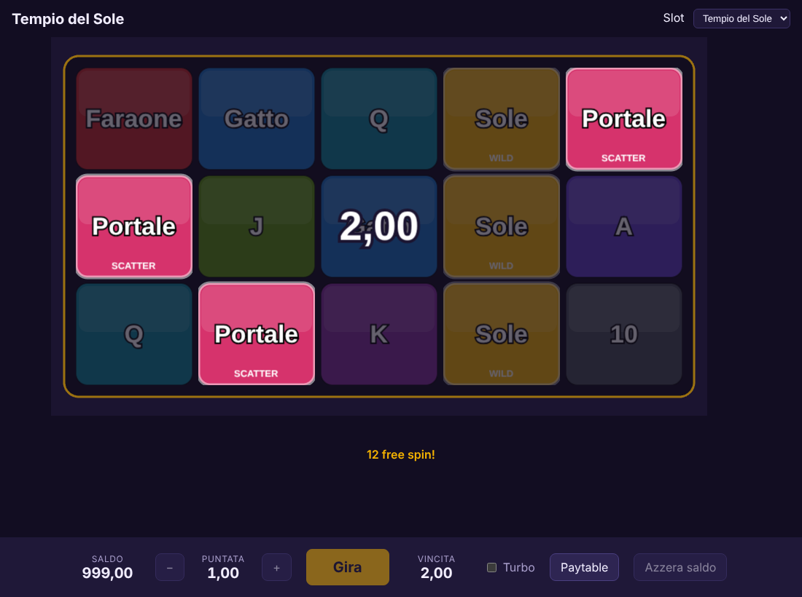

# Slot Simulator

Motore per creare slot machine moddabili: ogni slot è un **modulo** con regole, matematica, grafica e script separati, caricato da un motore comune.

Stato attuale: **fasi 1, 2 e 3**. Il nucleo matematico gestisce linee, wild, scatter, wild espandenti, free spin con riattivazione, upgrade dei simboli e tetto di vincita, con un simulatore da riga di comando e il calcolo esatto dell'RTP dello spin base. Un client PixiJS nel browser fa giocare le slot con grafica provvisoria. La bozza di architettura completa è nel documento di progetto.



## Requisiti

- Node.js 20 o superiore

```
npm install
```

## Comandi

| Comando | Cosa fa |
| --- | --- |
| `npm run dev` | avvia il client nel browser su http://localhost:5173 |
| `npm run build:app` | crea la versione statica del client in `dist-app/` |
| `npm run sim -- slots/tempio-del-sole` | simula 1.000.000 di round e stampa RTP, frequenza vincite, volatilità, statistiche dei free spin |
| `npm run sim -- slots/tempio-del-sole --spins 5000000 --seed 42` | numero di round e seed a scelta; lo stesso seed dà sempre lo stesso risultato |
| `npm run sim -- slots/tempio-del-sole --exact` | RTP esatto dello spin base e frequenza esatta dei free spin, in meno di un secondo |
| `npm run sim -- slots/tempio-del-sole --json` | risultato in JSON |
| `npm test` | test automatici |
| `npm run typecheck` | controllo dei tipi TypeScript |

Un **round** è uno spin base più gli eventuali free spin che attiva. Esempio di output:

```
Tempio del Sole 0.3.0: 2.000.000 round, seed 42, 20.9 s
  RTP simulato        94.84% ± 0.76% (95%)
    spin base         73.32%  (esatto 73.52%)
    free spin         21.52%
  Frequenza vincite   28.27% (1 round su 3.5)
  Deviazione std      5.49x
  Vincita massima     414.80x (round n. 1034150)
  Tetto di vincita    5000x, raggiunto 0 volte
  Free spin:
    attivazione       1 round su 175 (esatto 1 su 175.4)
    spin per bonus    17.1 in media
    vincita media     37.65x
    upgrade medio     livello 2.49
```

## Formato di un modulo

Un modulo è una cartella dentro `slots/`. Per installare un mod basta estrarre il suo zip lì.

```
slots/tempio-del-sole/
  manifest.json        id, nome, versione, autore, versione dell'API del motore
  math/reels.json      righe visibili e strisce dei rulli per modalità (base e, facoltativa, free)
  math/lines.json      linee di pagamento: per ogni rullo, la riga toccata (0 = in alto)
  math/paytable.json   simboli, pagamenti su linea e pagamenti scatter
  math/features.json   facoltativo: wild espandenti, free spin, upgrade, tetto di vincita
  scenes/main.json     facoltativo: colore di sfondo, colori ed etichette dei simboli
```

Regole di pagamento:

- **Linee:** si paga la corsa di simboli uguali partendo dal rullo più a sinistra. I pagamenti sono multipli della puntata per linea; la vincita totale è riportata in multipli della puntata totale.
- **Wild:** sostituisce i simboli normali, non lo scatter. Se una corsa di soli wild paga più del simbolo sostituito, si paga quella.
- **Scatter:** paga ovunque compaia sulla griglia, in multipli della puntata totale. Con più scatter dell'ultimo valore indicato vale l'ultimo valore.

### Funzioni bonus (`features.json`)

```json
{
  "expandingWild": { "reels": [2, 3, 4] },
  "freeSpins": {
    "trigger": { "minScatters": 3, "spins": { "3": 12 } },
    "retrigger": true,
    "perExpandedWild": { "extraSpins": 1, "upgrade": true },
    "upgradeLadder": ["GATTO", "SCARABEO", "ANKH", "FARAONE"]
  },
  "maxWin": 5000
}
```

- **Wild espandenti:** sui rulli indicati (da 1) un wild copre tutta la colonna, tranne gli scatter, che restano visibili e contano.
- **Free spin:** partono con `minScatters` scatter nello spin base e usano le strisce `free` se ci sono. Con `retrigger` gli scatter durante i free spin ne aggiungono altri.
- **Per ogni wild espanso durante i free spin:** `extraSpins` free spin in più e, con `upgrade`, un livello di upgrade per gli spin successivi. Al livello L i primi L simboli di `upgradeLadder` diventano il simbolo di posizione L.
- **Tetto di vincita:** `maxWin` limita la vincita di un round, in multipli della puntata totale, e ferma i free spin quando viene raggiunto.
- `maxSpins` (predefinito 1000) è un limite di sicurezza ai free spin di un round.

Il caricatore controlla la coerenza tra i file (simboli non definiti, linee fuori griglia, pagamenti impossibili) e riporta tutti i problemi in un solo messaggio.

## Il client

A ogni merge su `main` il client viene pubblicato su GitHub Pages (`.github/workflows/pages.yml`), all'indirizzo https://shyamasundara888.github.io/Slot-Simulator/. Va attivato una volta in Settings → Pages scegliendo "GitHub Actions" come sorgente; su un repository privato serve un piano GitHub a pagamento.

Il client (`app/`) è una pagina Vite con PixiJS. Include nel bundle tutti i moduli presenti in `slots/` e li mostra nel menu in alto.

- Il motore decide l'intero round prima che parta l'animazione; il client mostra soltanto l'esito: rulli che si fermano uno alla volta, celle trasformate da upgrade ed espansioni, linee vincenti, contatore dei free spin.
- Saldo virtuale di 1.000 crediti, salvato nel browser; puntata totale da 0,10 a 50; modalità turbo; paytable generata dalla matematica del modulo.
- Barra spaziatrice per girare. `?slot=<id>` apre una slot precisa, `?seed=<valore>` rende ripetibile la sequenza dei round.
- Finché un modulo non ha asset, i simboli sono tessere colorate con l'etichetta definita in `scenes/main.json`; i simboli senza stile ricevono un colore predefinito.

## Come funziona

- `src/core/rng.ts`: generatore pseudo-casuale con seed (sfc32), estrazioni senza bias.
- `src/core/engine.ts`: round completo (spin base e free spin), upgrade, wild espandenti, tetto di vincita.
- `src/core/evaluate.ts`: valutazione di linee, wild e scatter.
- `src/module/`: schema dei file e validazione (`parse.ts`, usato anche dal browser), lettura da disco (`load.ts`).
- `src/sim/exact.ts`: RTP esatto dello spin base. Su una linea i rulli sono indipendenti, quindi basta enumerare le combinazioni di simboli invece di tutte le posizioni di arresto; con i wild espandenti la distribuzione di ogni cella tiene conto della finestra del suo rullo. I free spin dipendono dallo stato del round e si misurano con la simulazione.
- `src/sim/simulate.ts`: simulazione Monte Carlo per round con intervallo di confidenza, RTP diviso tra spin base e free spin, frequenza vincite, deviazione standard, fasce di vincita e statistiche dei free spin.

## Prossime fasi

4. Scripting Lua con hook sul ciclo dello spin.
5. Caricamento dei mod da zip e seconda slot di esempio.
6. Editor visuale, dopo che il motore si è stabilizzato.
7. API per integrare le slot in un gioco più grande.
